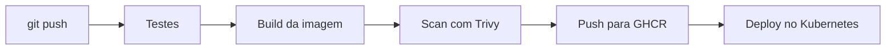

# 🚀 Node.js CI/CD com Docker e Kubernetes


Esse projeto nasceu de uma pergunta simples: **o que acontece entre o `git push` e o código rodando em produção?**

Em vez de ler sobre isso, montei a esteira inteira. A cada push na `main`, o código é testado, empacotado em uma imagem Docker, verificado contra vulnerabilidades e publicado automaticamente em um cluster Kubernetes. Sem passos manuais.

> A aplicação é propositalmente simples. O foco aqui é o **processo de entrega**, não o código.

## 📊 Status

- [x] Aplicação Node.js com testes automatizados
- [x] Dockerfile com usuário não-root
- [ ] Manifestos Kubernetes
- [ ] Pipeline no GitHub Actions
- [ ] Deploy automático em cluster

## 🗺️ Como funciona



Cada etapa só começa se a anterior passar. Se um teste quebra ou o Trivy encontra uma vulnerabilidade grave, **nada chega à produção**.

## 🧰 Tecnologias

| Ferramenta | Para que uso |
|---|---|
| Node.js + Express | Aplicação de exemplo |
| node:test | Testes automatizados (nativo, sem dependência extra) |
| Docker | Empacotamento da aplicação |
| Trivy | Scan de vulnerabilidades na imagem |
| GitHub Actions | Automação da esteira |
| GHCR | Registry das imagens |
| Kubernetes | Execução com 2 réplicas, readiness probe e limites de recursos |

## 🧠 Decisões que tomei (e por quê)

- **Imagem marcada com o SHA do commit**, e não só `latest`. Assim sei exatamente qual versão está rodando e consigo voltar atrás se algo der errado.
- **Trivy antes do push**: a imagem só vai para o registry depois de aprovada, então uma imagem vulnerável nunca fica disponível.
- **`npm ci` em vez de `npm install`**: garante as mesmas versões de dependência no meu computador e no pipeline.
- **Usuário não-root no container** e imagem `slim`, para reduzir a superfície de ataque.
- **Limites de CPU e memória** nos pods, para uma aplicação com defeito não derrubar o restante do cluster.
- **`rollout status` no deploy**: o pipeline só fica verde quando o Kubernetes confirma que a nova versão subiu de verdade.

## 🛠️ Rodando localmente

```bash
git clone https://github.com/nicolejsdev/nodejs-cicd-kubernetes.git
cd nodejs-cicd-kubernetes

# testes
cd app && npm ci && npm test && cd ..

# container
docker build -t meu-app:teste .
docker run -p 8000:8000 meu-app:teste
```

Acesse http://localhost:8000

## 📸 Evidências

(adicionar depois que a esteira estiver rodando)

## 🔧 Perrengues e aprendizados

(escreva aqui, com suas palavras, 2 ou 3 problemas reais que você enfrentou e como resolveu)

## 👩‍💻 Sobre mim

Sou a Nicole, estou em transição para DevOps e documento minha jornada nos meus laboratórios:
[linux-labs](https://github.com/nicolejsdev/linux-labs) · [docker-labs](https://github.com/nicolejsdev/docker-labs) · [kubernetes-labs](https://github.com/nicolejsdev/kubernetes-labs)
EOF
