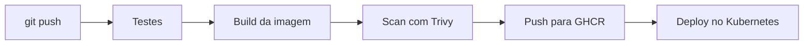
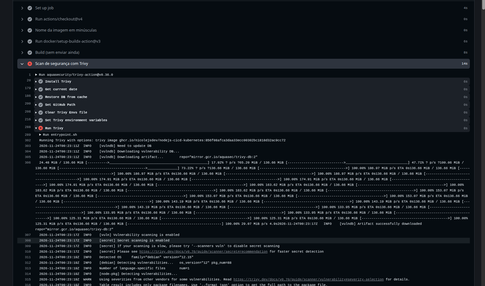
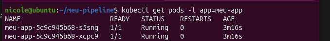
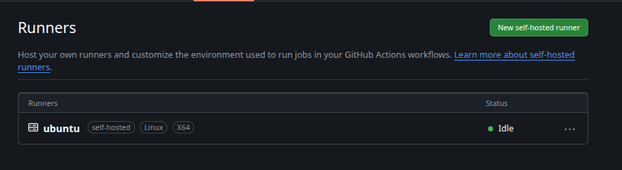
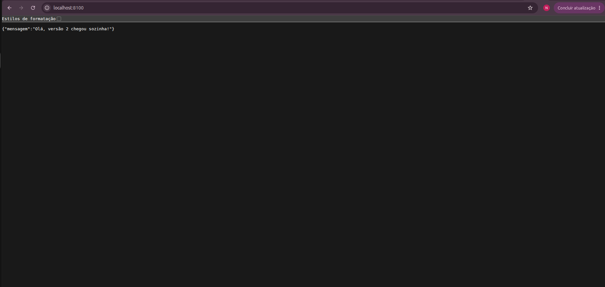

# 🚀 Node.js CI/CD com Docker e Kubernetes

Esse projeto nasceu de uma pergunta simples: **o que acontece entre o `git push` e o código rodando em produção?**

Em vez de só ler sobre isso, montei a esteira inteira. A cada push na `main`, o código é testado, empacotado em uma imagem Docker, verificado contra vulnerabilidades e publicado automaticamente em um cluster Kubernetes. Sem passos manuais.

> A aplicação é propositalmente simples. O foco aqui é o **processo de entrega**, não o código.

## 📊 Status

- [x] Aplicação Node.js com testes automatizados
- [x] Dockerfile multi-stage com usuário não-root
- [x] Manifestos Kubernetes
- [x] Pipeline no GitHub Actions
- [x] Scan de segurança com Trivy bloqueando o deploy
- [x] Deploy automático em cluster (kind, via runner self-hosted)

## 🗺️ Como funciona



Cada etapa só começa se a anterior passar. Se um teste quebra ou o Trivy encontra uma vulnerabilidade grave, **nada chega ao cluster**.

## 📸 Evidências

**Pipeline:**


**O Trivy barrando o deploy (vulnerabilidades HIGH com correção disponível):**



**Pods rodando no Kubernetes com a imagem gerada pelo pipeline:**



**Runner self-hosted conectado:**



**A versão 2 chegando sozinha, sem deploy manual:**



## 🧰 Tecnologias

| Ferramenta | Para que uso |
|---|---|
| Node.js + Express | Aplicação de exemplo |
| node:test | Testes automatizados (nativo, sem dependência extra) |
| Docker (multi-stage) | Empacotamento da aplicação |
| Trivy | Scan de vulnerabilidades na imagem |
| GitHub Actions | Automação da esteira |
| GHCR | Registry das imagens |
| Kubernetes (kind) | 2 réplicas, readiness probe e limites de recursos |
| Runner self-hosted | Deploy no cluster local |

## 🧠 Decisões que tomei (e por quê)

- **Imagem marcada com o SHA do commit**, e não só `latest`: sei exatamente qual versão está rodando e consigo voltar atrás.
- **Trivy antes do push**: uma imagem vulnerável nunca chega ao registry.
- **`npm ci` em vez de `npm install`**: mesmas versões no meu computador e no pipeline.
- **Build multi-stage sem o npm na imagem final**: em produção só preciso do Node, então a imagem fica menor e com menos superfície de ataque.
- **Usuário não-root** no container e **limites de CPU e memória** nos pods.
- **`rollout status` no deploy**: o pipeline só fica verde quando o Kubernetes confirma que a nova versão subiu.
- **Runner self-hosted**: o GitHub não alcança o cluster do meu notebook, então só o job de deploy roda na minha máquina. Testes e build rodam nos servidores do GitHub.

## 🔧 Perrengues e aprendizados

**1. Action do Trivy com versão que não existia.**
O build falhou em poucos segundos com "unable to find version". Olhei a aba *Annotations* da execução, vi a mensagem, fui nos *releases* do repositório da action e corrigi para a tag real. Aprendi a não confiar em versão de memória e a ler a anotação antes de abrir o log inteiro.

**2. O Trivy barrou o deploy por vulnerabilidades HIGH.**
Parte vinha de dependências do Express e parte do npm que vem embutido na imagem base. Atualizei o Express e passei a usar build multi-stage, entregando uma imagem final sem o npm (que nem roda em produção). Aprendi que um scan reprovando não é falha da esteira: é ela funcionando.

**3. Porta 8000 ocupada por um container antigo.**
O `docker run` falhou com "port is already allocated". Rodei `docker ps`, achei o container esquecido e o parei. Aprendi a conferir o que já está rodando antes de culpar o código.

**4. Push rejeitado pelo GitHub.**
O remoto tinha um commit que eu não tinha localmente. Resolvi com `git pull --rebase` e enviei de novo. Aprendi a diferença entre o histórico local e o remoto.

**5. Esteira falhando e eu sem enxergar o motivo.**
Achei que o arquivo do workflow não tinha sido enviado, mas ele já estava no GitHub: as execuções vermelhas estavam na aba Actions. Aprendi a olhar a aba Actions primeiro, antes de suspeitar do Git.

## 🛠️ Rodando localmente

```bash
git clone https://github.com/nicolejsdev/nodejs-cicd-kubernetes.git
cd nodejs-cicd-kubernetes

# testes
cd app && npm ci && npm test && cd ..

# container
docker build -t meu-app:teste .
docker run -p 8000:8000 meu-app:teste
```

## 👩‍💻 Sobre mim

Sou a Nicole, estou em transição para DevOps e documento minha jornada nos meus laboratórios:
[linux-labs](https://github.com/nicolejsdev/linux-labs) · [docker-labs](https://github.com/nicolejsdev/docker-labs) · [kubernetes-labs](https://github.com/nicolejsdev/kubernetes-labs)
